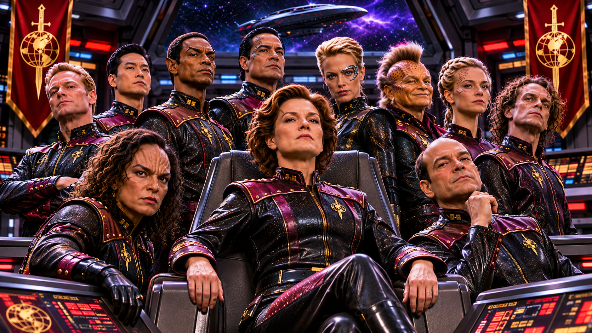

# Star Trek: Mirror Voyager

> **One ship. Two rival factions. Seventy thousand light-years from home.**

An unofficial fan-created alternate-universe reimagining of *Star Trek: Voyager*. The **ISS Voyager** is a Terran Empire warship stranded in the Delta Quadrant alongside former Maquis rebels. Captain Janeway wants to return home to seize the Imperial throne; Chakotay and B’Elanna Torres want to dismantle the Empire.

## Explore the universe

- 📖 [Complete story guide](docs/STORY_GUIDE.md)
- 👥 [Mirror Universe crew dossiers](characters/README.md)
- 🚀 [Episode and story outlines](episodes/README.md)
- 💬 [How to contribute](CONTRIBUTING.md)

## Core continuity

- Janeway seeks to **capture** the Caretaker’s array, not destroy it to save the Ocampa.
- Chakotay orders **Maquis sabotage**, and Tuvok covertly helps; the array is destroyed accidentally.
- B’Elanna retains her **Maquis background** and remains a revolutionary.
- Harry Kim deliberately stays an **ensign** because low rank makes him easy to underestimate.
- The Doctor develops a conscience; Kes sees possible futures; Suder struggles to choose restraint.

## Featured stories

- **The Caretaker:** A conquest denied
- **The 37’s:** Amelia Earhart challenges Janeway
- **Equinox:** The Emperor’s Mercy
- **The Delta Quadrant War:** The Empire tries to conquer the quadrant

## Sharing

Share this repository's homepage with fellow fans: https://github.com/lcahlander/Star-Trek-Mirror-Voyager

## Disclaimer

Unofficial, noncommercial fan fiction and AI-generated concept artwork. Not affiliated with or endorsed by Paramount, CBS, or the *Star Trek* rights holders. *Star Trek* names and characters belong to their respective rights holders.
