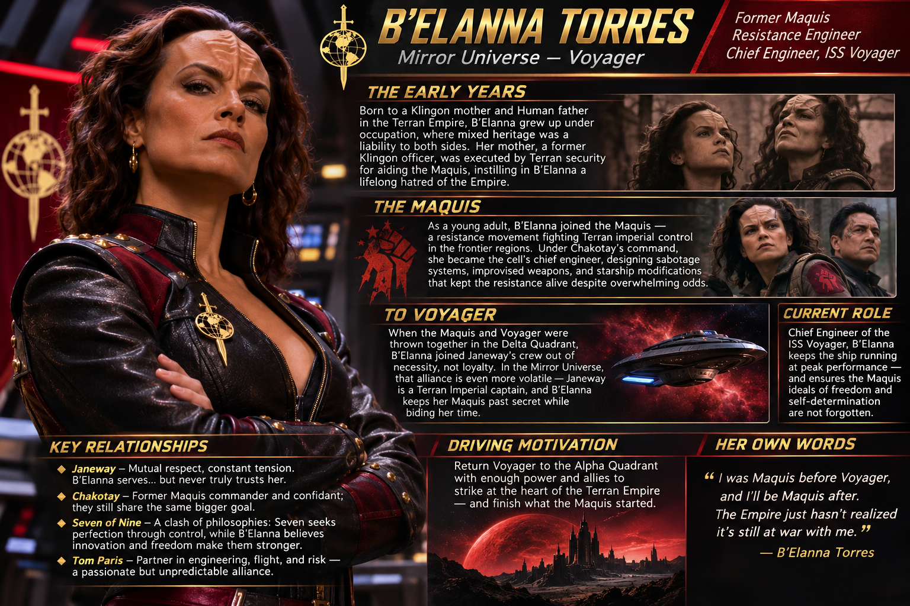

# B’Elanna Torres

**Role:** Maquis saboteur and chief engineer

A former Maquis saboteur, not an Academy-trained loyalist. Her mother resisted Terran occupation; her father betrayed the resistance. She secretly develops propulsion technology to bring Voyager home as a weapon of liberation.

*Unofficial AI-generated fan artwork and AI-assisted fan-fiction.*
