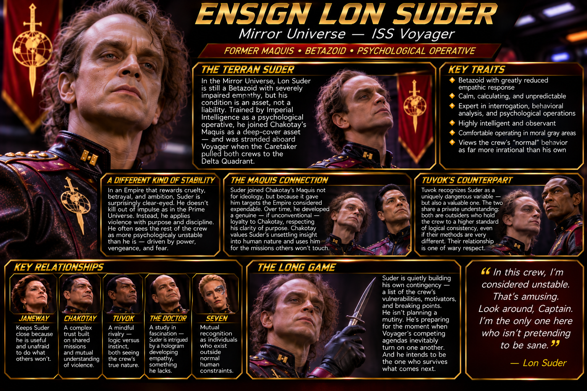

# Lon Suder

**Role:** Former Maquis operative committed to restraint

A former Maquis operative with violent impulses who deliberately chooses restraint. Tuvok helps him develop a moral code; aboard this ship, Suder’s refusal to kill becomes an act of rebellion.

# Episodes and turning points

*Unofficial AI-generated fan artwork and AI-assisted fan-fiction.*
