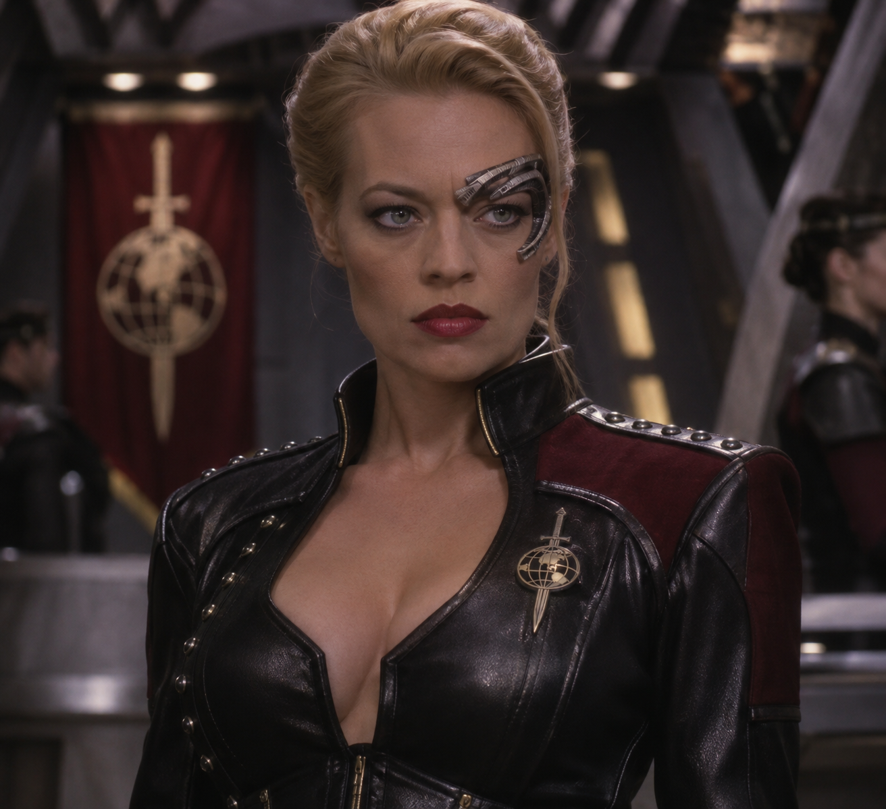

# Seven of Nine

**Role:** Former Borg drone and technologist

A liberated Borg drone who believes her technological superiority entitles her to shape the future. Her rivalry with B’Elanna pits centralized control against rebellious innovation.

*Unofficial AI-generated fan artwork and AI-assisted fan-fiction.*
