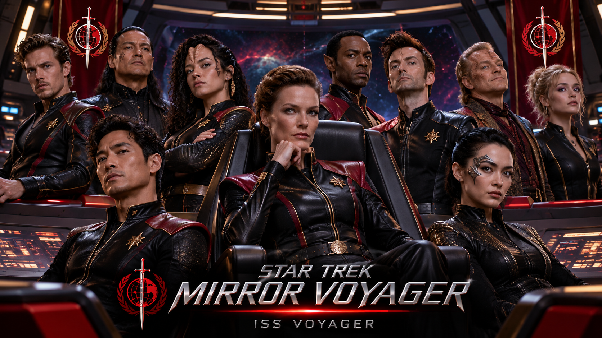

# Mirror Voyager — Modern Dream Cast (2026)

An **unofficial fan-casting concept** for a contemporary adaptation of *Star Trek: Mirror Voyager*. These actors are suggestions only; **none is attached to this project**.

| Character | Suggested performer | Interpretation |
|---|---|---|
| Kathryn Janeway | Rebecca Ferguson | Imperial captain determined to claim the throne |
| Chakotay | Michael Greyeyes | Veteran Maquis resistance commander |
| B'Elanna Torres | Amber Midthunder | Maquis engineer and daughter of the House of Varek |
| Tuvok | Chiwetel Ejiofor | Vulcan intelligence operative with divided loyalties |
| Tom Paris | Austin Butler | Disgraced Imperial pilot |
| Harry Kim | Manny Jacinto | Underestimated ensign and secret intelligence broker |
| Seven of Nine | Jessica Henwick | Liberated Borg technologist with imperial ambitions of her own |
| The Doctor | David Tennant | Imperial medical hologram developing a conscience |
| Neelix | Alan Tudyk | Talaxian smuggler, cook, and information dealer |
| Kes | Ella Purnell | Ocampa psychic who sees possible futures |
| Lon Suder | Barry Keoghan | Former Maquis assassin struggling toward restraint |
| Empress Georgiou II | Michelle Yeoh | Proposed reigning sovereign on Voyager's return |
| Q | Tom Hiddleston | Omnipotent observer who puts the Empire on trial |

## The premise

In an alternate history where the Terran Empire survived into 2371, the ISS Voyager pursues Chakotay's Maquis ship into the Badlands and is stranded in the Delta Quadrant. Janeway dreams of returning to seize the throne; Chakotay and B'Elanna seek to overthrow it; Harry Kim quietly accumulates power while remaining an ensign.

This fan-casting lineup is **not a replacement for the existing character dossiers**. It is a proposed contemporary screen interpretation of the same original fan-fiction continuity.

## Shareable post

**STAR TREK: MIRROR VOYAGER — A MODERN DREAM CAST**

What if Voyager were a Terran Empire warship, stranded 70,000 light-years from home? Rebecca Ferguson commands the ISS Voyager as Janeway; Michael Greyeyes leads the Maquis as Chakotay; Amber Midthunder is B'Elanna; Chiwetel Ejiofor is Tuvok; Austin Butler is Tom Paris; Manny Jacinto is Harry Kim; Jessica Henwick is Seven of Nine; David Tennant is the Doctor; Alan Tudyk is Neelix; Ella Purnell is Kes; and Barry Keoghan is Lon Suder. Michelle Yeoh would appear as Empress Georgiou II, with Tom Hiddleston as Q.

One ship. Two rival factions. And an ensign who might become Emperor.

Who would you cast differently?

https://github.com/lcahlander/Star-Trek-Mirror-Voyager

*Unofficial fan casting, AI-assisted fan fiction and AI-generated concept art. No cast participation or studio affiliation is implied.*
