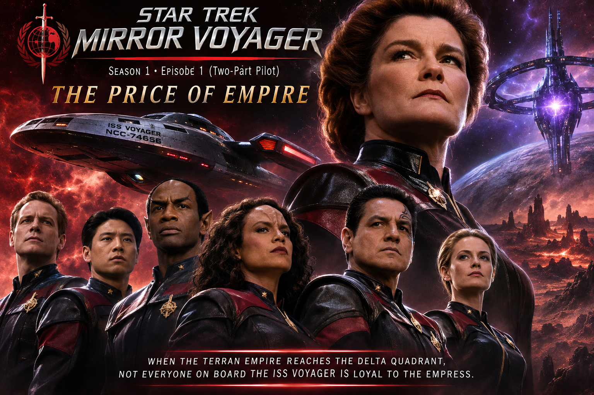

# Episodes and story arcs

These are original fan-fiction treatments.

- [The Caretaker](the-caretaker.md) — Janeway tries to seize the array; Maquis sabotage strands Voyager.
- [The 37’s](the-37s.md) — Amelia Earhart and a free human colony challenge Imperial rule.
- [Equinox — The Emperor’s Mercy](equinox.md) — Ransom’s ISS Equinox uses sentient beings as propulsion fuel.
- [The Delta Quadrant War](delta-quadrant-war.md) — After homecoming, the Empire attempts a conquest via transwarp corridors.

## Pilot screenplay

- [The Price of Empire — Part One](the-price-of-empire-part-one.md) — Expanded teleplay draft.

- [Q — The Trial of Empire](q-trial-of-empire.md) — the Continuum tests Janeway's vision of humanity.
