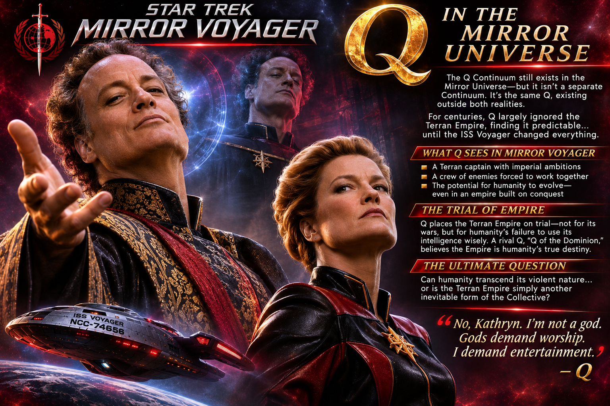

# Q — The Trial of Empire

**Status:** Proposed *Mirror Voyager* episode concept; not established Star Trek canon.

## One Continuum across realities

In this fan-fiction interpretation, the Q Continuum exists outside the Prime and Mirror Universes, rather than having separate counterparts in each. Q finds the Terran Empire predictable until the stranded ISS Voyager begins to change.

A second member of the Continuum, nicknamed **Q of the Dominion**, believes that conquest is humanity's natural destiny. The two put Mirror Janeway on trial and present two futures: imperial victory ending in collapse, or surrender of the throne in favor of independent worlds.

Janeway rejects the forced choice. Neither Q, she argues, has the right to dictate humanity's future.

> **JANEWAY:** “Are you a god?”  
> **Q:** “No, Kathryn. Gods demand worship. I demand entertainment.”

*An original, unofficial fan-fiction treatment, not a claim about established canon.*
